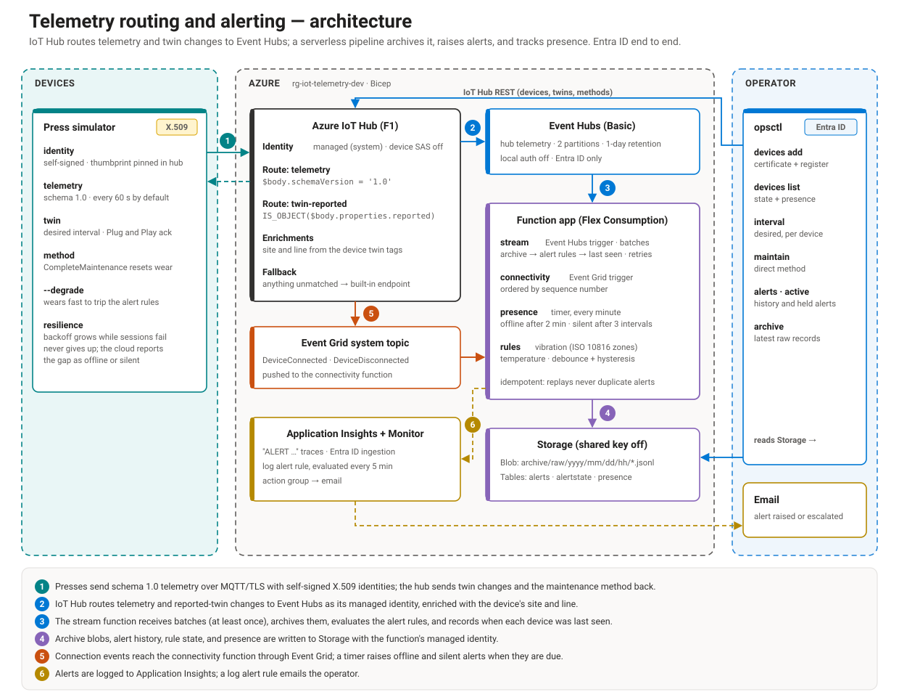
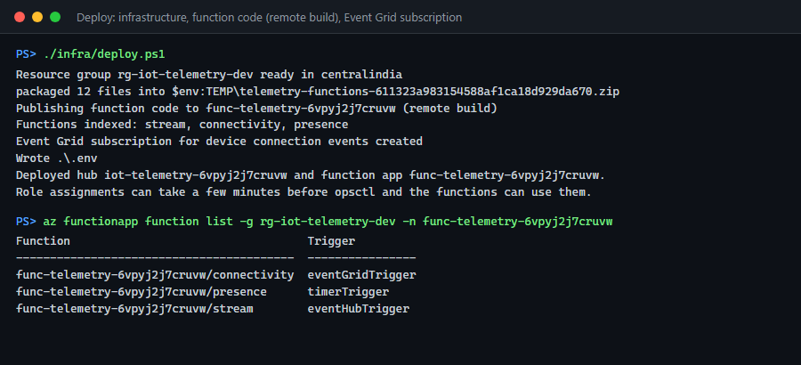
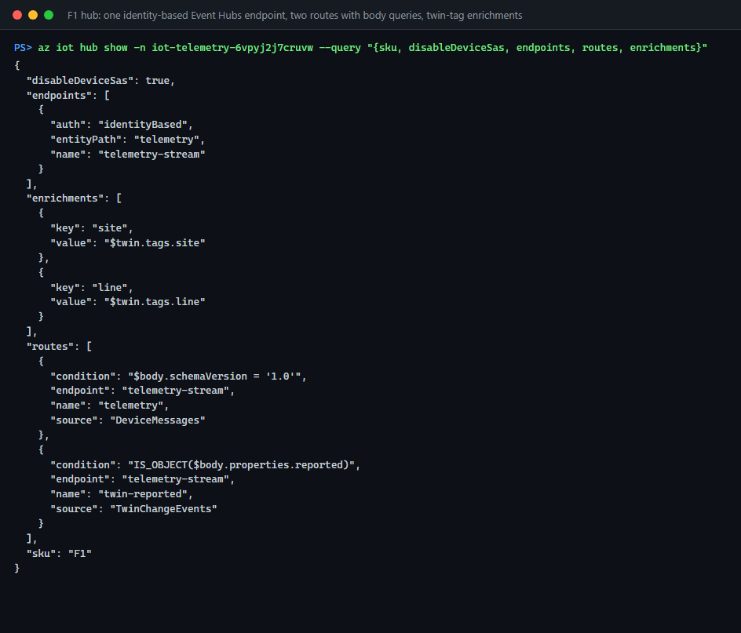
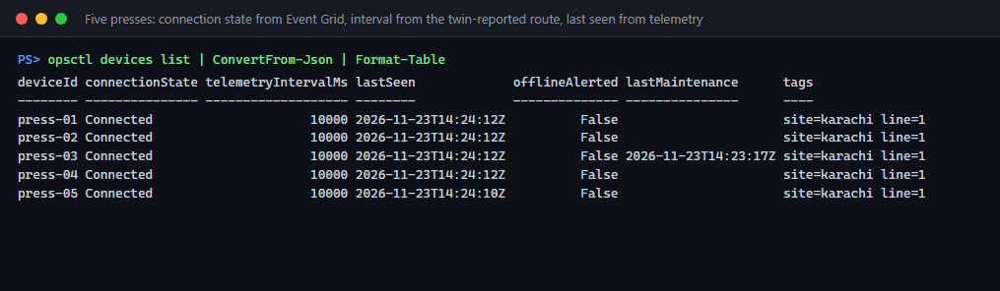
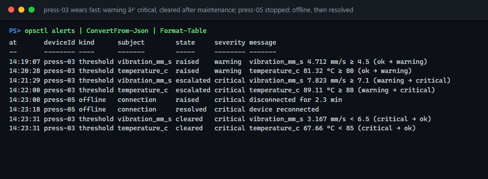
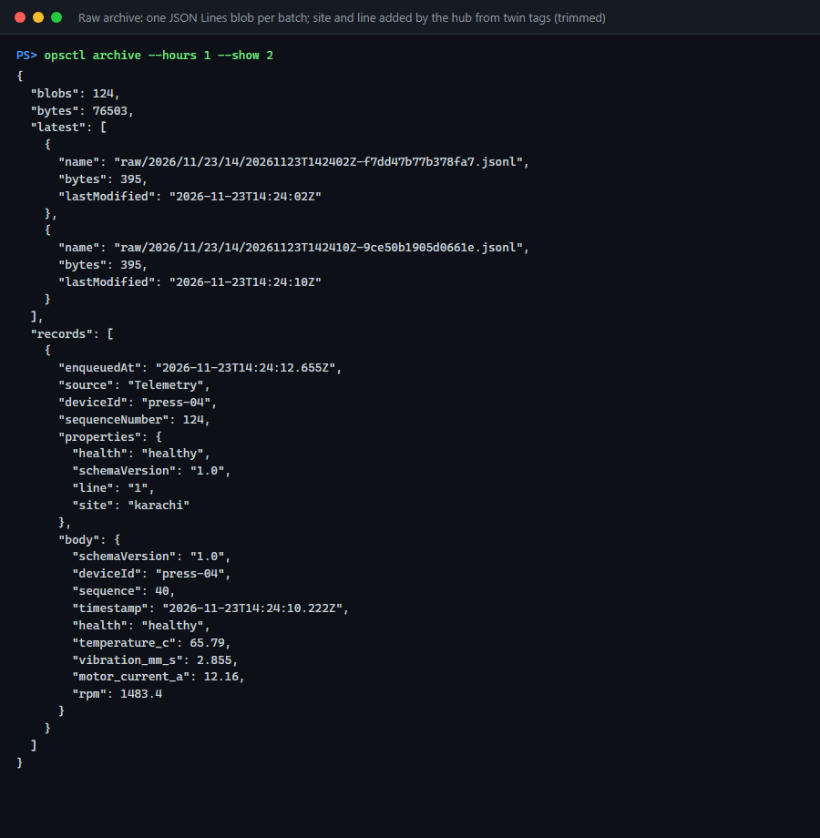
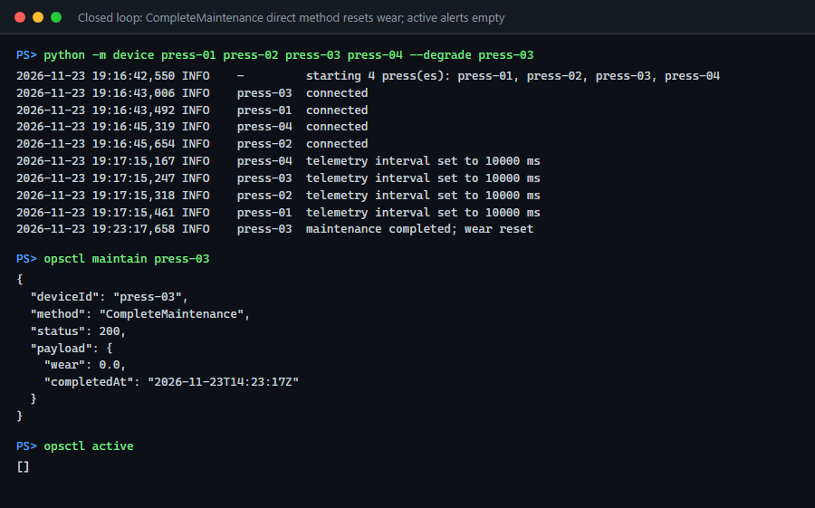

# Azure IoT Telemetry Routing & Alerting

> IoT Hub message routing into an event-driven Azure Functions pipeline that archives every
> message, raises threshold alerts with debounce and hysteresis, and tracks whether each
> device is online, all authenticated with Microsoft Entra ID end to end.



Simulated presses send telemetry to IoT Hub. The hub routes it, together with the devices'
reported twin changes, to Event Hubs using its managed identity. A Flex Consumption function
app archives each batch to Blob storage, evaluates alert rules per device, and combines
Event Grid connection events with last-seen times to detect devices that go offline or
silent. Alerts land in Table storage and in Application Insights, where an Azure Monitor
rule emails the operator. `opsctl` manages devices and reads the results.

## What it demonstrates

| Capability | How |
|------------|-----|
| **Message routing** | Two routes with queries (`$body.schemaVersion = '1.0'`, `IS_OBJECT($body.properties.reported)`), message enrichments from twin tags, fallback to the built-in endpoint ([ADR 0001](docs/adr/0001-routing-on-a-free-hub.md)) |
| **Serverless stream processing** | Event Hubs trigger with batches and an exponential retry policy; every step idempotent under at-least-once delivery |
| **Alert rules** | ISO 10816 vibration zones and temperature limits, two-reading debounce, hysteresis, raised / escalated / eased / cleared transitions ([ADR 0003](docs/adr/0003-alert-rules.md)) |
| **Device presence** | Event Grid connection events ordered by sequence number, last-seen telemetry, offline and silent alerts with optimistic concurrency ([ADR 0004](docs/adr/0004-device-presence.md)) |
| **Raw archive** | One JSON Lines blob per batch under `raw/yyyy/mm/dd/hh/`, named so redelivery overwrites instead of duplicating |
| **Notifications** | `ALERT` traces in Application Insights and a log alert rule with an email action group |
| **Closed loop** | `opsctl maintain` calls the `CompleteMaintenance` direct method; the press resets and its alerts clear |
| **Resilient devices** | Reconnect backoff that grows while sessions fail, recovery from dropped connections and quota refusals |

## Security

- **No keys anywhere:** local authentication is disabled on Event Hubs, Storage (shared key
  off), Application Insights, and Log Analytics; device SAS is disabled on the hub.
- **Managed identities:** the hub sends to Event Hubs as itself; the function app reads Event
  Hubs, writes Storage, and publishes telemetry as itself ([ADR 0002](docs/adr/0002-entra-id-end-to-end.md)).
- **Least privilege:** each identity holds only the data roles it uses, scoped to one resource.
  The operator gets *IoT Hub Data Contributor* and read-only Table and Blob roles.
- **Devices:** self-signed X.509 certificates with the thumbprint pinned in the hub; keys are
  written owner-only and gitignored.

## Quickstart

**Prerequisites:** Python 3.12+, Azure CLI (`az login`, `az bicep install`), and a subscription
with no existing free IoT hub (Azure allows one per subscription).

```powershell
# 1. Python environment
python -m venv .venv; .venv\Scripts\activate
pip install -r requirements-dev.txt

# 2. Azure: IoT Hub, Event Hubs, storage, function app, Event Grid, monitoring; writes .env
./infra/deploy.ps1 -AlertEmail you@example.com

# 3. Five presses: certificates, hub registration, and twin tags for the enrichments
python -m service devices add press-01 press-02 press-03 press-04 press-05 --tag site=karachi --tag line=1

# 4. Run four presses, press-03 wearing fast (terminal 1), and press-05 alone (terminal 2)
python -m device press-01 press-02 press-03 press-04 --degrade press-03
python -m device press-05

# 5. Faster telemetry for the demo, then watch (terminal 3)
python -m service interval --all --ms 10000
python -m service devices list
python -m service alerts
python -m service active
python -m service archive --show 3

# 6. Stop press-05 (Ctrl+C in terminal 2): an offline alert follows within about three minutes

# 7. Maintenance on press-03 resets its wear; its alerts clear
python -m service maintain press-03

# 8. Remove everything
./infra/teardown.ps1
```

`opsctl` (installed by `pip install -e .`) is the same CLI as `python -m service`.
Exit codes: `0` success, `1` operation failed, `2` invalid input or configuration.

## Verified live

Run end to end on Azure on 2026-11-23 (Central India, free hub), then torn down.

| Step | Result |
|------|--------|
| Deploy | Infrastructure, remote build on Flex Consumption, all three functions indexed, Event Grid subscription to the `connectivity` function |
| Routing | Identity-based Event Hubs endpoint; body queries match telemetry and reported-twin changes; `site` and `line` enrichments arrive on every routed message |
| Presence | Connection state from Event Grid (disconnect seen 7 s after the device stopped), interval from the twin-reported route, last seen from telemetry |
| Alerts | press-03 (`--degrade`): vibration and temperature raised as warnings, escalated to critical, and cleared after `maintain`; press-05 stopped: offline after 2.3 minutes, resolved on reconnect |
| Notifications | Each raised or escalated alert reached Application Insights as an `ALERT` trace at warning level, the input the email rule queries |








## Tests and CI

```powershell
ruff check . ; ruff format --check . ; pytest
```

The alert rules, presence logic, event parsing, archive naming, storage mapping, batch
processing (including redelivery, conflicts, and failure ordering), the function bindings,
the device runtime, the packager, and the CLI are covered with in-memory fakes, so no Azure
is needed. GitHub Actions runs lint, format, and tests on Python 3.12 and 3.13, and compiles
the Bicep.

## Project layout

```
functions/     Azure Functions app: function_app.py (entry points), pipeline/ (all logic)
device/        press simulator: X.509 identity, telemetry, twin, maintenance method
service/       opsctl: IoT Hub REST and Storage readers with Entra ID
infra/         Bicep (main, hub routing, Event Grid), packaging, deploy and teardown
tests/         unit tests with in-memory fakes
docs/          architecture diagram, ADRs, screenshots
```

## Cost

**Well under $1 for a demo day.** The free IoT hub costs nothing (8,000 messages a day; the
60 s default keeps five presses inside it). Event Hubs Basic is billed by the hour, about
$0.36 a day, so run `infra/teardown.ps1` when finished. Flex Consumption, Event Grid, and
Storage stay within free grants or cents at this volume; Log Analytics ingestion is a few
megabytes.

## Design decisions

- [ADR 0001](docs/adr/0001-routing-on-a-free-hub.md): message routing on a free hub
- [ADR 0002](docs/adr/0002-entra-id-end-to-end.md): Entra ID end to end, on Flex Consumption
- [ADR 0003](docs/adr/0003-alert-rules.md): threshold alerts with debounce, hysteresis, and idempotent processing
- [ADR 0004](docs/adr/0004-device-presence.md): device presence from connection events and last-seen telemetry
